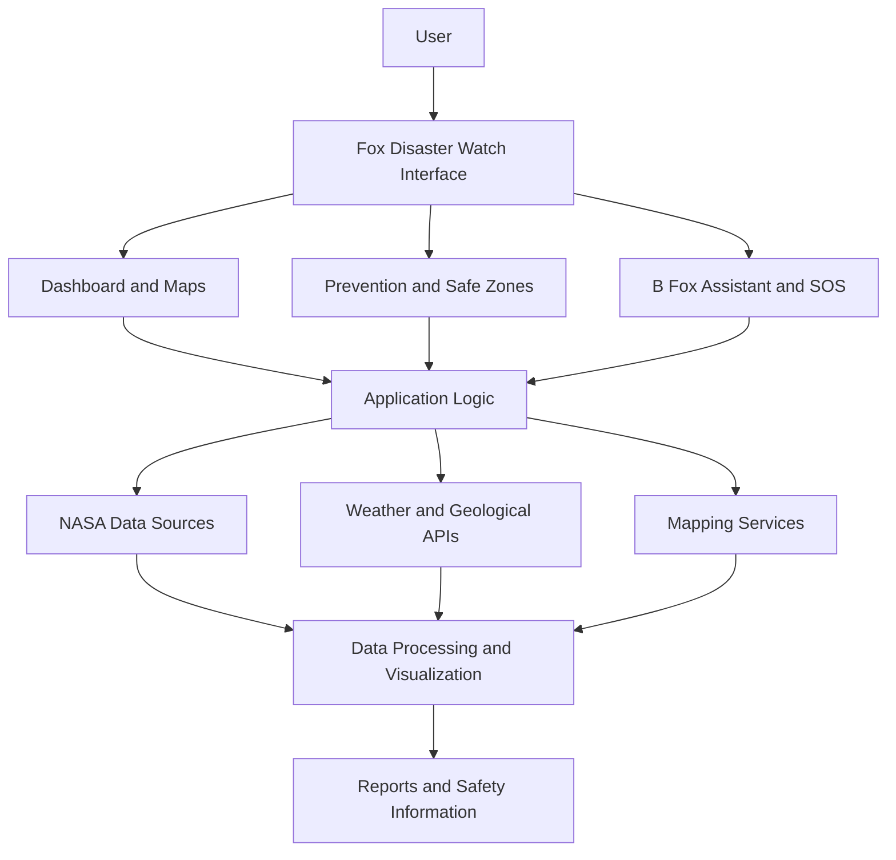

# Fox Disaster Watch 
### Disaster Awareness, Risk Analysis & Preparedness

**Team:** B Big Fox  
**Challenge:** Be an earth system trend detective  
**Institution:** G H Raisoni Skill Tech University, Nagpur, Maharashtra, India

<p align="center">
  <a href="https://fox-disaster-sentinel.lovable.app">Live Demo</a> ·
  <a href="https://github.com/pranaydahat9-hash/NASA_b_big_fox_NSA-04-1447">GitHub Repository</a>
</p>

---


We want to build a satellite database disaster management app. 
We are focusing right now on mobile, Flutter, and all that. We will show that first demo to the judge and then we will think to build the solution. It is a space challenge, a NASA space challenge.  
Tech Stack

Frontend: Jetpack Compose with Kotlin

Backend: Firebase (Auth, Realtime DB, Cloud Messaging)

ML/AI: TensorFlow Lite, ML Kit, Aurora AI integration

APIs: OpenWeatherMap, USGS, Emergency Alert Systems

Maps: Google Maps SDK with offline capabilities

Database: Room Database for offline caching
1. Weather Data Integration

Real-time weather data from OpenWeatherMap API

Historical weather pattern analysis

Severe weather alert parsing

2. AI/ML Models

Flood Prediction: Random Forest model for rainfall/soil moisture analysis

Wildfire Detection: CNN models for satellite imagery analysis

Hurricane Tracking: Aurora AI integration for path prediction

Earthquake Monitoring: USGS data integration with threshold analysis

3. Alert System

Push notifications via Firebase Cloud Messaging

SMS integration for emergency contacts

Severity-based alert prioritization

False alarm reduction algorithms

4. Emergency Features

GPS-based evacuation route planning

Offline emergency maps

SOS system with location sharing

Emergency contact integration

5. User Interface

Real-time disaster risk dashboard

Interactive maps with overlay data

Crowdsourced disaster reporting

Multi-language support and accessibility
https://github.com/vat72926/calculator/issues/2#issue-3139748920
https://github.com/vat72926/calculator/issues/1#issue-3139737356

This project was built with [Lovable](https://lovable.dev).

**Live app**: https://horizon-hazard-halo.lovable.app

Continue developing this project in the [Lovable editor] https://fox-disaster-sentinel.lovable.app

# 1. Project Title & Problem Statement

## Project Title

**Fox Disaster Watch — Disaster Awareness and Preparedness Platform**

**Official Challenge Title:** Be an earth system trend detective

## Problem Statement

Natural disasters such as floods, wildfires, cyclones, earthquakes, and extreme weather events can threaten human lives, infrastructure, and the environment. However, disaster-related information is often scattered across different platforms, making it difficult for people to understand local hazards, assess changing environmental conditions, and prepare for emergencies.

Fox Disaster Watch aims to make disaster-related information more accessible by bringing geographical information, environmental observations, hazard awareness, and preparedness resources into a unified application.

The project emphasizes **early awareness, prevention, and informed decision-making** to help people understand potential risks and prepare before emergencies occur.

## Project Objectives

- Improve access to location-specific disaster information.
- Explore relevant NASA Earth observation data and other authoritative sources.
- Present available hazard indicators through maps and visualizations.
- Encourage preventive action through disaster-specific safety guidance.
- Support access to safe-zone information and emergency resources.
- Facilitate incident reporting and awareness of regional hazards.
- Promote transparent, source-based disaster information.

---

# 2. Team Details

**Team Name:** B Big Fox

**Home Institution:** G H Raisoni Skill Tech University, Nagpur, Maharashtra, India. Individual institutional affiliations should be confirmed before submission.

| Full Name | GitHub Username | Role |
|---|---|---|
| Shubhankar Das | [@notshubhankar](https://github.com/notshubhankar) | Captain |
| Pranay Dahat | [@pranaydahat9-hash](https://github.com/pranaydahat9-hash) | member |
| Ishan Tiwari | [@Ishan-max17](https://github.com/Ishan-max17) | member |
| Hansika Lone | [@hansikalone-ai](https://github.com/hansikalone-ai) | member |
| Kunal Dewangan | [@kunaldewanga09-oss](https://github.com/kunaldewanga09-oss) | member |


---

# 3. Solution Overview & Architecture

## Solution Overview

Fox Disaster Watch is a disaster awareness and preparedness platform designed to help users explore environmental hazards, understand location-based information, and access relevant safety resources.

The project combines a web-based user interface with planned and configured data integrations to support disaster monitoring, geographical exploration, and preventive decision-making.

## Key Features

### Disaster Dashboard
- Centralized access to available disaster-related information.
- Hazard indicators and regional conditions where supported.
- Clear presentation of available observations and timestamps.

### Interactive Disaster Maps
- Search and explore geographical locations.
- View available hazard information and map overlays.
- Access safe-zone information where implemented and available.
- Support location-based disaster awareness.

### NASA and Environmental Data
The project is intended to use relevant Earth observation and environmental datasets to support disaster awareness.

Potential data sources include NASA FIRMS for active fires, NASA Earthdata for Earth observation datasets, and suitable meteorological and geological data services. Each integration must be verified against the actual implementation before being described as operational.

### Hazard Analysis and Prevention
- Present available environmental observations and historical trends.
- Help users understand hazard indicators.
- Provide preventive guidance and preparedness information.
- Distinguish observed events from forecasts and experimental predictions.

### B Fox AI Assistant — Planned/Integration-Dependent
The proposed B Fox assistant is intended to support text and voice interaction, answer questions about available information, and help users navigate the application.

Application control, spoken responses, and automated emergency actions depend on the corresponding integrations being implemented and tested.

### SOS and Emergency Assistance — Planned/Integration-Dependent
The intended emergency workflow includes manual SOS activation, emergency contacts, location sharing, and message delivery through a configured service. These capabilities must be tested before being represented as fully operational.

### Disaster Reports — Implementation-Dependent
The planned reporting functionality includes structured disaster summaries, charts, maps, timestamps, source references, and PDF export where supported.

Reports should distinguish verified observations from forecasts and clearly disclose missing data.

## System Architecture

The following diagram represents the proposed high-level architecture, not a claim that every connection is already implemented.



## Technology Stack

| Component | Technology |
|---|---|
| Application development | Lovable |
| Version control | Git and GitHub |
| Frontend framework | To be verified from repository |
| Programming language | To be verified from repository |
| Data integrations | NASA and other APIs, where configured |
| Mapping | Configured mapping provider |
| Backend and storage | To be verified from repository |
| AI assistant and voice | Integration-dependent |

Only technologies and services confirmed in the source code should be identified as implemented components.

---

# 4. Live Demo & Screenshots

## Live Application

**[Open Fox Disaster Watch](https://fox-disaster-sentinel.lovable.app)**

## Source Code

**[View the GitHub Repository](https://github.com/pranaydahat9-hash/NASA_b_big_fox_NSA-04-1447)**

## Application Screenshots


## Application Screenrecording

https://github.com/user-attachments/assets/552f932b-5451-45ad-b1df-9e8d5cf75ede

---

# 5. Installation & Setup Guide

## Prerequisites

- Git
- Node.js and npm
- API credentials required by the configured services, if applicable

## Installation Steps

### Step 1: Clone the repository

```bash
git clone https://github.com/pranaydahat9-hash/NASA_b_big_fox_NSA-04-1447.git
```

### Step 2: Navigate to the project directory

```bash
cd NASA_b_big_fox_NSA-04-1447
```

### Step 3: Install dependencies

```bash
npm install
```

### Step 4: Configure environment variables

Review the repository's environment configuration and any available `.env.example` file.

Configure the API keys and service credentials required by the actual implementation. Never commit private keys, passwords, or secrets to the repository.

### Step 5: Start the development server

```bash
npm run dev
```

Open the local URL displayed in the terminal.

**Note:** These instructions assume the repository contains a Node.js web application with the relevant npm scripts. Confirm the actual project configuration before submission.

## Troubleshooting

- Check that the installed Node.js version is compatible with the project.
- Verify that all dependencies install successfully.
- Confirm required API credentials and environment variables.
- Check the browser console and terminal for errors.
- Verify network connectivity and the availability of external APIs.

## Data Sources and References

The following official resources are relevant to the project's intended data integrations:

- [NASA Open APIs](https://api.nasa.gov/)
- [NASA FIRMS](https://firms.modaps.eosdis.nasa.gov/)
- [NASA Earthdata](https://www.earthdata.nasa.gov/)
- [NASA POWER](https://power.larc.nasa.gov/)
- [USGS Earthquake Catalog](https://earthquake.usgs.gov/earthquakes/search/)

These links are references for potential data sources. Their inclusion does not imply that every service has been integrated into the application.

---

# 6. AI Usage Disclosure

## AI Tool Used

**Lovable** — AI-assisted application development platform.

## Scope of AI Assistance

Lovable was used as an AI-assisted development tool for the project. Depending on the actual development workflow, its assistance may have included generating or modifying application code, developing interface components, and implementing requested features.

## Human Contribution and Verification

The team is responsible for reviewing and validating the submitted application, including:

- Reviewing the generated implementation.
- Checking feature behaviour and application navigation.
- Testing data integrations and location-based information.
- Verifying the accuracy and source attribution of displayed data.
- Testing emergency workflows before relying on them.
- Ensuring documentation accurately reflects the submitted project.

## Transparency Statement

AI assistance was used through Lovable. This disclosure should be updated if any additional AI tools were used during development, testing, or documentation.

All feature claims and technology descriptions should be checked against the final repository before submission.

---

## Data Accuracy and Safety Disclaimer

Fox Disaster Watch is an informational disaster awareness and preparedness project. The accuracy of its outputs depends on the availability, quality, and interpretation of its data sources and services.

The application does not replace official emergency warnings, professional assessments, or instructions from local authorities. Historical trends and experimental risk assessments cannot guarantee that a disaster will occur at a particular place or time.

Users should follow verified alerts and guidance from relevant emergency management agencies.

---

**Fox Disaster Watch — Understand the Risk. Prepare Early. Protect Lives.**


